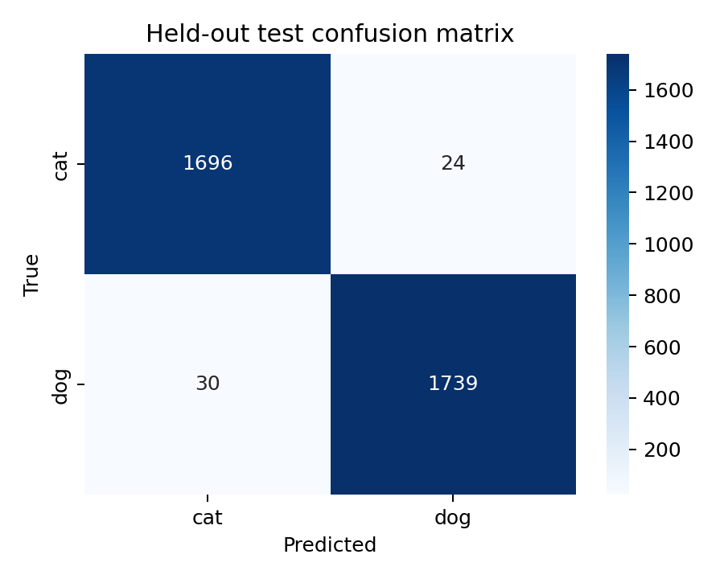
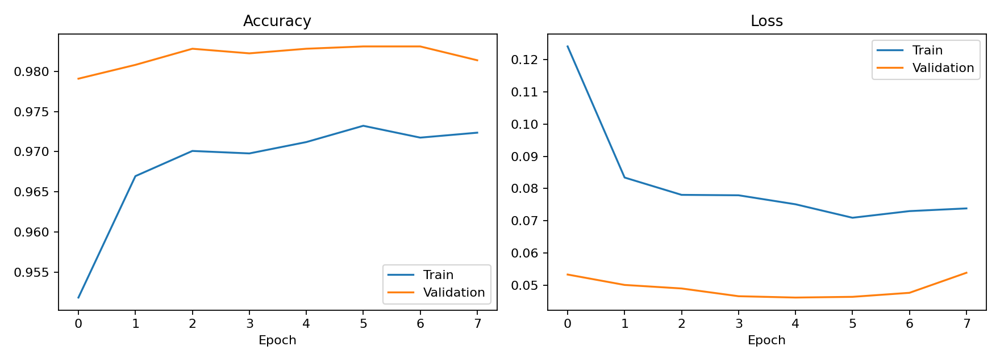
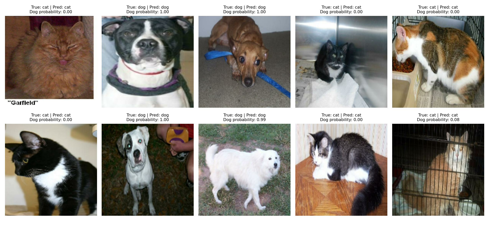

# Cats vs Dogs Image Classification

**AVIP 2026 | AI/ML Engineering | Task 1**

This project classifies images as **cat** or **dog** using **MobileNetV2** with transfer learning. The MobileNetV2 feature extractor uses ImageNet pretrained weights and remains frozen while a binary classification head is trained.

## Dataset

- **Dataset:** [Cats vs Dogs — TensorFlow Datasets](https://www.tensorflow.org/datasets/catalog/cats_vs_dogs)
- **Original source:** Microsoft Research
- **Usable images:** 23,262 (1,738 corrupted images excluded by TFDS)
- **Split:** 70% training, 15% validation, 15% held-out testing
- **Input size:** 160 × 160 RGB images

The dataset is downloaded automatically by TensorFlow Datasets when the notebook runs.

## Model and training

- MobileNetV2 pretrained on ImageNet (`include_top=False`), frozen backbone
- Training-only augmentation: horizontal flip, rotation, zoom
- Global average pooling, dropout (0.25), dense sigmoid output
- Adam optimizer, binary cross-entropy loss
- Images resized to 160 × 160; MobileNetV2 preprocessing is included **inside the saved model**

## Held-out test results

| Metric | Value |
|---|---:|
| Test accuracy | 98.45% |
| Precision (dog class) | 98.64% |
| Recall (dog class) | 98.30% |
| F1-score (dog class) | 98.47% |
| Test samples | 3,489 |

### Confusion matrix



### Training curves



### Ten sample predictions



## Run the training notebook

1. Open `TASK1_AVIP.ipynb` in [Google Colab](https://colab.research.google.com/).
2. Select a GPU runtime if available.
3. Run cells from top to bottom. The first run downloads the TFDS dataset.
4. The notebook saves `outputs/best_model.keras`, `outputs/metrics.json`, and result images.

## Run inference with the saved model

The model expects an RGB image resized to 160 × 160, with pixel values on a **0–255 scale**. Do not apply MobileNetV2 normalization again: it is already part of the saved model.

```python
import numpy as np
import tensorflow as tf

model = tf.keras.models.load_model('outputs/best_model.keras')
img = tf.keras.utils.load_img('your_image.jpg', target_size=(160, 160))
image = np.expand_dims(tf.keras.utils.img_to_array(img), axis=0)
p_dog = float(model.predict(image, verbose=0)[0][0])
label = 'dog' if p_dog >= 0.5 else 'cat'
confidence = p_dog if label == 'dog' else 1 - p_dog
print(f'{label}: {confidence:.1%}')
```

## Project files

- `TASK1_AVIP.ipynb`: training and evaluation notebook
- `outputs/best_model.keras`: saved classifier
- `outputs/metrics.json`: test metrics
- `outputs/confusion_matrix.png`: confusion matrix
- `outputs/training_curves.png`: training curves
- `outputs/10_test_predictions.png`: sample predictions and ground-truth labels

## Project summary (under 300 words)

A Cats vs Dogs image classifier was developed using MobileNetV2 transfer learning. The TensorFlow Datasets Cats vs Dogs collection provided 23,262 usable images, divided into training (70%), validation (15%), and held-out testing (15%). Image preprocessing resized inputs to 160 × 160 pixels. A pretrained MobileNetV2 backbone extracted image features, while a custom binary classification head was trained. The final evaluation on 3,489 test images achieved 98.45% accuracy. Evaluation artifacts include precision, recall, F1-score, a confusion matrix, training curves, and ten test predictions with ground-truth labels. The saved Keras model can be loaded to classify new images.
